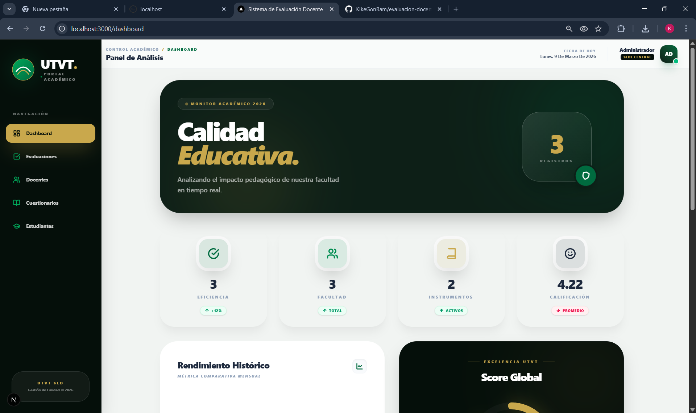
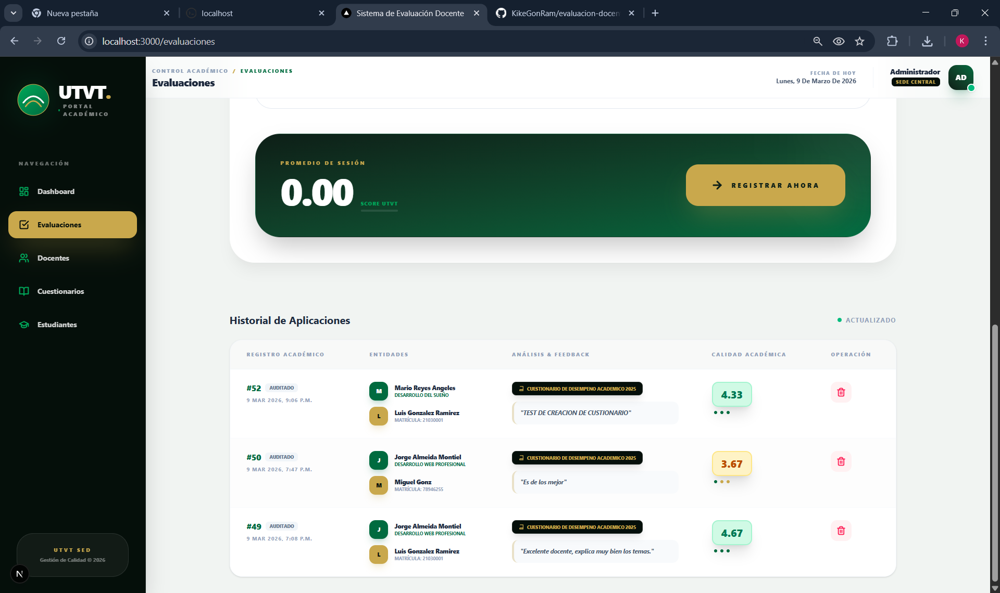
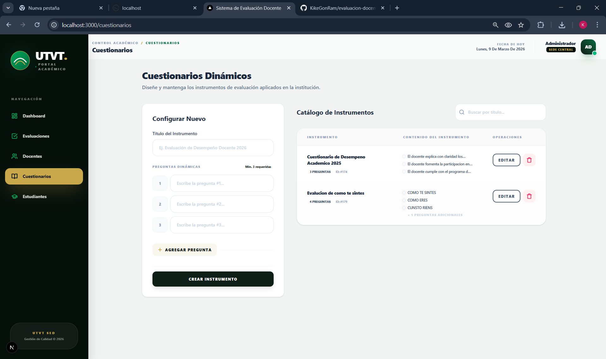
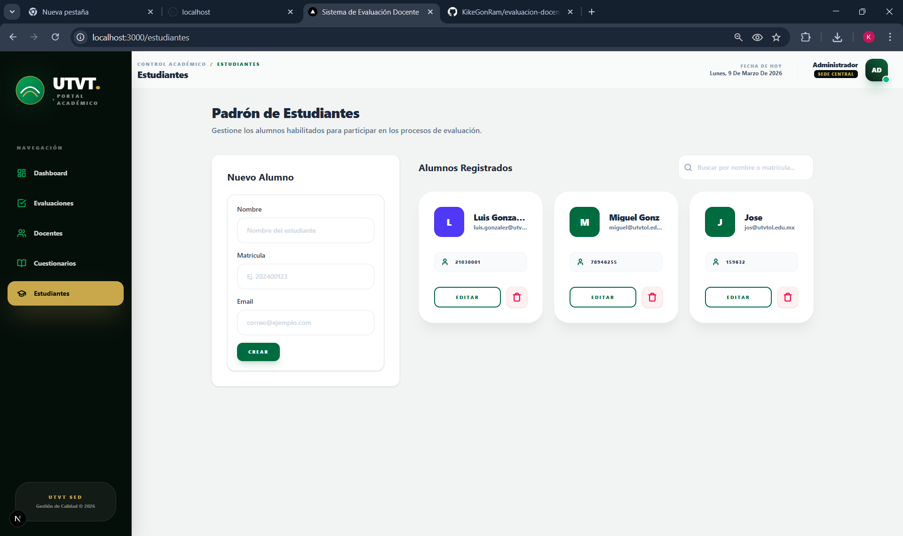

# Evaluación Docente — Frontend (SED · UTVT)

Interfaz web del **Sistema de Evaluación Docente (SED)** de la Universidad Tecnológica del Valle de Toluca. Construida en **Next.js 15** y **Tailwind CSS v4**, consume la API en **Java / Spring Boot** para gestionar docentes, estudiantes, cuestionarios y evaluaciones.


🔗 **Demo:** [evaluacion-docente-frontend.vercel.app](https://evaluacion-docente-frontend.vercel.app) · **Backend:** [evaluacion-docente-api](https://github.com/KikeGonRam/evaluacion-docente-api)

## Características

- **Dashboard** con métricas clave e indicadores de tendencia.
- **Analítica visual:** gráficas de rendimiento y calidad académica.
- **Gestión institucional:** docentes, estudiantes, cuestionarios y aplicaciones de evaluación.
- **Feedback narrativo:** componente `ActionFeedback` con animaciones de éxito y error.
- **Identidad UTVT:** paleta institucional (verde y dorado).

## Arquitectura

El frontend (Next.js) consume la API REST de Spring Boot. La ruta `app/backend/[...path]/route.ts` actúa como proxy hacia el backend, evitando exponer su URL directamente al navegador.

```
app/
├── page.tsx                 # Inicio
├── dashboard/page.tsx       # Métricas y analítica
├── docentes/page.tsx        # Gestión de docentes
├── estudiantes/page.tsx     # Gestión de estudiantes
├── cuestionarios/page.tsx   # Cuestionarios
├── evaluaciones/page.tsx    # Aplicaciones de evaluación
└── backend/[...path]/route.ts  # Proxy a la API Spring Boot
```

## Puesta en marcha

Requiere la API de Spring Boot en ejecución (por defecto en el puerto `8080`).

```bash
git clone https://github.com/KikeGonRam/evaluacion-docente-frontend.git
cd evaluacion-docente-frontend
npm install
npm run dev
```

Define la URL de la API en `.env.local`:

```env
NEXT_PUBLIC_API_URL=http://localhost:8080/api
```

### Scripts

| Comando | Para |
| --- | --- |
| `npm run dev` | Desarrollo con recarga |
| `npm run build` | Compilar para producción |
| `npm start` | Servir la build |
| `npm run lint` | Revisar el código con ESLint |

## Vista previa

| Dashboard institucional | Formulario de evaluación |
|---|---|
|  |  |

| Cuadro de honor | Feedback de usuario |
|---|---|
|  |  |

## Tecnologías

Next.js 15 · React · TypeScript · Tailwind CSS v4 · API REST en Java / Spring Boot

---

Proyecto de Luis Enrique González Ramírez — [github.com/KikeGonRam](https://github.com/KikeGonRam)
